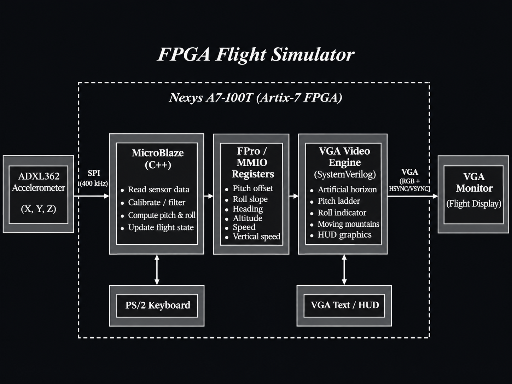

# FPGA Flight Simulator

**ECE 4305/L — Advanced Digital Design Using SystemVerilog**  
**Cal Poly Pomona**  
**Team:** Christian Ruelas and Jonathan Kwon  
**Hardware:** Digilent Nexys A7-100T (Artix-7 FPGA)  
**Tools:** Vivado, Vitis  
**Languages:** SystemVerilog, C++

## Table of contents

- [Overview](#overview)
- [System architecture](#system-architecture)
  - [Architecture summary](#architecture-summary)
  - [What runs in C++?](#what-runs-in-c)
  - [What runs in SystemVerilog?](#what-runs-in-systemverilog)
  - [Custom video core and FPro](#custom-video-core-and-fpro)
- [Implemented features](#implemented-features)
- [Requirements and status](#requirements-and-status)
- [Planned integration](#planned-integration)
- [Development workflow](#development-workflow)
- [Demo checklist](#demo-checklist)
- [Team](#team)

## Overview

This project is an interactive FPGA-based flight display and simulator built around the course **FPro** system. Tilting the Nexys A7 board changes the attitude shown on an external VGA monitor. The display includes an artificial horizon, pitch ladder, roll reference, three snowcapped mountains, and moving clouds. A MicroBlaze soft processor reads the onboard ADXL362 accelerometer over SPI, estimates pitch and roll, maintains additional simulated flight variables, and writes display parameters to memory-mapped FPGA registers.

Custom SystemVerilog video cores generate the flight scene directly from pixel coordinates and registered control values. The C++ application also projects mountain vertices and cloud positions from simulated 3D world coordinates into VGA screen coordinates. This separates software-based sensor processing, flight-state updates, and scene geometry from continuous hardware-based video rendering.

> **Project status:** The accelerometer-driven VGA flight display, three snowcapped mountains, and moving clouds have been demonstrated on the Nexys A7. PS/2 input and readable on-screen flight telemetry are planned/in progress and are **not yet claimed as complete** here. See [Requirements and status](#requirements-and-status).

## System architecture

<p align="center">
  
</p>

### Architecture summary

1. **ADXL362 measures acceleration.** The onboard accelerometer senses changes in the gravity vector as the Nexys A7 board is tilted.
2. **C++ reads sensor data using SPI.** MicroBlaze receives X, Y, and Z acceleration values through the FPro SPI core.
3. **C++ calculates pitch and roll.** The firmware applies calibration, converts measurements into attitude angles, and updates simulated flight variables.
4. **C++ writes display parameters to FPro registers.** The hardware stores values such as pitch offset, roll slope, mountain triangle edges/colors, and cloud screen positions.
5. **SystemVerilog evaluates each pixel using those values.** The rendering pipeline checks whether the current pixel belongs to the sky, ground, mountain faces and snowcaps, clouds, pitch ladder, roll scale, or aircraft marker.
6. **The VGA pipeline outputs the selected RGB color.** The monitor receives the completed pixel stream and displays the updated flight scene.

### What runs in C++?

MicroBlaze executes the C++ application to:

1. Configure the SPI interface and verify the ADXL362 device ID (`0xF2`).
2. Collect and calibrate the three-axis accelerometer measurements.
3. Estimate the board's pitch and roll relative to its initial level orientation, with filtering to reduce jitter.
4. Update the **simulated** heading, altitude, airspeed, and vertical speed. These are **not** independent measurements from the accelerometer.
5. Calculate the aircraft's movement through a simple 3D world and project mountain vertices and cloud positions onto the VGA display.
6. Convert attitude estimates and projected scenery into integer/fixed-point display parameters and write them to video cores through FPro memory-mapped I/O.
7. Read onboard switches to adjust simulated airspeed (SW0–SW3) and reset/hold the simulation (SW15).
8. Print flight-state information to the UART terminal for debugging.

The accelerometer supports tilt estimation under steady or slow movement. It is **not** a complete inertial-navigation system or an absolute heading sensor.

### What runs in SystemVerilog?

The FPGA video logic processes the current pixel coordinate `(x, y)` and determines its RGB output. The horizon core uses stored pitch and roll display parameters to calculate the position of the sky-ground boundary:

```text
horizon_y(x) = 240 + pitch_offset + (((x - 320) * roll_slope) >>> 8)
```

The arithmetic uses signed, fixed-point values: the right shift rescales the roll-related product. The mountain core rasterizes triangular faces using edge equations, including snowcap faces with separate colors. The cloud core draws three cloud shapes at screen positions provided by MicroBlaze, preserving the existing mountain graphics by drawing clouds only over sky-colored pixels. The HUD overlays the pitch ladder, roll scale, downward-pointing roll marker, and fixed aircraft reference.

Unlike C++, which executes instructions on MicroBlaze, these video circuits exist independently in FPGA fabric. The pixel stream continues while the processor reads the accelerometer and updates registers.

### Custom video core and FPro

The design integrates several custom SystemVerilog video cores into the course FPro video system:

| Video slot | Core | Purpose |
| --- | --- | --- |
| `V0_SYNC` | VGA synchronization | Outputs the completed video stream |
| `V1_HORIZON` | `flight_horizon_core` | Draws sky/ground and supplies HUD attitude parameters |
| `V2_OSD` | On-screen display | Reserved for readable flight telemetry |
| `V3_MOUNTAIN` | `flight_mountain_core` | Renders three snowcapped mountains using triangle faces |
| `V4_CLOUD` | `flight_cloud_core` | Draws three clouds at memory-mapped screen positions |
| `V5_GRAY` | Grayscale core | Existing FPro video stage |
| `V6_BAR` | Color bar core | Existing FPro video stage |
| `V7_UNUSED` | Unused | Available for future expansion |

Each custom renderer receives:

- Pixel coordinates (`x`, `y`) and an incoming RGB stream (`si_rgb`)
- FPro-derived register signals (`cs`, `write`, `addr`, `wr_data`)
- An outgoing RGB stream (`so_rgb`) for subsequent video stages

The slot numbers select **memory-mapped control addresses**, not the order in which pixels are rendered. The actual RGB pipeline is:

```text
Frame Buffer → Color Bar → Grayscale → Horizon → Mountains → Clouds → HUD → OSD → VGA
```

## Implemented features

- Accelerometer-driven pitch and roll on the VGA flight display
- ADXL362 communication over the FPro SPI core
- Startup level calibration and smoothed attitude response
- Artificial horizon with sky and ground
- Moving/rotating pitch ladder and roll reference
- Downward-pointing triangle roll marker and fixed aircraft reference
- Three snowcapped mountains with multiple colored triangular faces
- Perspective-projected mountain scenery that moves with simulated flight and aircraft orientation
- Three moving clouds with world positions projected into VGA screen coordinates
- Cloud rendering behind the HUD and in front of sky pixels, without covering mountain faces
- Simulated heading, altitude, airspeed, and vertical speed
- Switch-controlled airspeed (SW0–SW3) and simulation reset/hold (SW15)
- UART flight telemetry for debugging
- Custom SystemVerilog rendering integrated with the FPro video pipeline

### Selected design refinements

The team has corrected pitch direction to match the desired board movement, resolved a right-edge video artifact, adjusted the pitch-ladder range to reduce clutter, and refined line thickness and roll-marker placement for readability on the VGA monitor. The scenery has expanded from a basic horizon and animated mountains to three snowcapped mountains and clouds whose displayed positions change with the simulated aircraft. Video slot names have also been reorganized to reflect their actual functions.

## Requirements and status

| Course requirement | Current status | How this project addresses it |
| --- | --- | --- |
| Meaningful FPro-based task | **Implemented** | Sensor-to-display flight simulator using FPro cores and custom logic |
| At least one SPI, I2C, XADC, or audio I/O core | **Implemented** | SPI communication with ADXL362 |
| PS/2 keyboard or PS/2 mouse | **Planned / in progress** | Keyboard controls for simulator interaction |
| VGA moving sprite **or object** | **Implemented** | Moving artificial horizon, pitch ladder, snowcapped mountains, and clouds |
| VGA on-screen text | **Planned / in progress** | Flight telemetry / instrument labels rendered on VGA |
| New video-core functionality (extra credit) | **Implemented** | Custom `flight_horizon_core`, `flight_mountain_core`, and `flight_cloud_core` |

## Planned integration

### PS/2 input

Add a PS/2 keyboard interface through the FPro system. Proposed controls include resetting the simulation, pausing/resuming, adjusting simulated speed, and showing/hiding display elements. Final key bindings will be documented after implementation.

### VGA on-screen text

Use an on-screen-display or custom text renderer to show live values such as `PITCH`, `ROLL`, `HDG`, `ALT`, `SPD`, and `VS` on the VGA monitor. These readouts should remain screen-aligned while the artificial horizon moves and rotates.

### Integration and testing

Verify keyboard input and on-screen text independently, then merge both into the working video pipeline. Confirm they do not interfere with accelerometer reading, FPro register writes, frame timing, mountain/cloud movement, or existing HUD graphics.

## Development workflow

1. Open the team's **Vivado** project and use the board constraints and existing FPro hardware configuration.
2. Review the custom video cores, video-system integration, and FPro address definitions before modifying the register map.
3. Synthesize and implement the design; generate the FPGA bitstream.
4. Export the hardware platform to **Vitis** and build the MicroBlaze C++ application against the matching hardware design.
5. Program the Nexys A7 and run the application.
6. Connect a VGA monitor and a UART terminal. Follow the level-calibration prompt before tilting the board.
7. Verify pitch/roll response, snowcapped mountains, moving clouds, numeric UART telemetry, and—once merged—PS/2 controls and VGA text.

**Version note:** Exact Vivado/Vitis project paths, file layout, clock configuration, and programming steps depend on the committed project. Consult the actual Vivado/Vitis sources and constraints; do not assume that generated build files or exported hardware files are included in this repository.

## Demo checklist

- [x] Build and run the FPGA flight display
- [x] Identify ADXL362 over SPI
- [x] Calibrate the initial level orientation
- [x] Demonstrate pitch/roll changes on VGA
- [x] Show artificial horizon, pitch ladder, and moving mountain terrain
- [x] Display three snowcapped mountains
- [x] Display three moving clouds
- [x] Verify updated FPro video slot assignments
- [x] Show simulated flight-state values in the UART terminal
- [ ] Demonstrate PS/2 keyboard or mouse input
- [ ] Display readable on-screen text on VGA
- [ ] Record the final video demonstration
- [ ] Verify and submit all created/modified HDL, C/C++ drivers, and C/C++ application files

## Team

| Team member | Primary work area |
| --- | --- |
| **Christian Ruelas** | Current flight-display HDL, ADXL362 SPI integration, MicroBlaze C++ attitude / flight-state simulation |
| **Jonathan Kwon** | PS/2 input and VGA on-screen text integration |
| **Both** | System integration, validation, documentation, and final demo |
